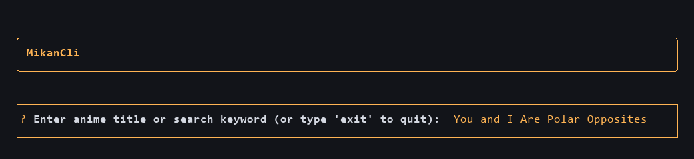
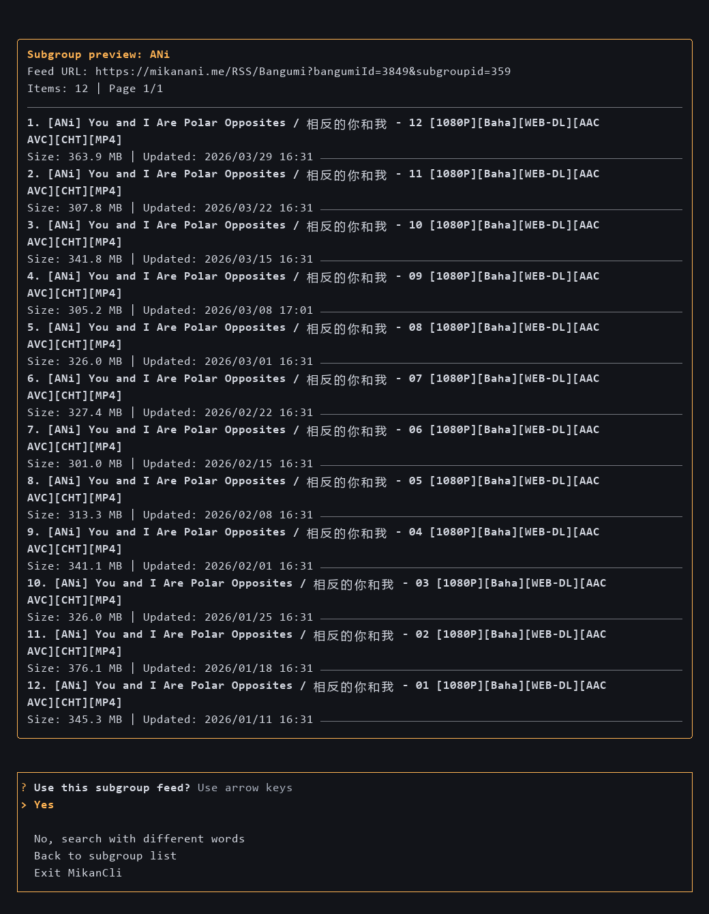

# MikanCli

Language: [简体中文](README.md) | [English](README.en.md)

Search anime on Mikan, choose a subgroup RSS feed, and create qBittorrent download rules from your terminal.

- Search anime and preview subgroup releases.
- Filter downloads by included words, excluded words, and minimum episode.
- Submit RSS feeds and rules to qBittorrent and verify they were saved.
- Automate the workflow with noninteractive JSON commands.

## Install

Requires Python 3.10 or newer. Install with `pipx`:

```bash
pipx install mikancli
```

If you don't have `pipx`:

```bash
python -m pip install --user pipx
python -m pipx ensurepath
```

Reopen your terminal, then run `pipx install mikancli`.

## Usage

```bash
mikancli
```

Search for an anime, choose a subgroup, preview releases, set filters and a download folder, then submit the rule. The menu also provides qBittorrent setup and language selection.

You can supply a title and filters to start the guided flow:

```bash
mikancli "one piece" --include SubsPlease --exclude 720p --min-episode 1126
```

Minimum episode filtering supports titles such as `One Piece - 1126` and `[One Piece][1126]`.

## qBittorrent Setup

Enable WebUI in qBittorrent's settings, then connect MikanCli:

```bash
mikancli --setup-qbittorrent
```

Enter the WebUI URL and credentials. The default URL is `http://localhost:8080`. Leave credentials blank only if your WebUI allows local access without authentication.

## Agents and Scripts

These commands run without prompts and return JSON:

```bash
mikancli search "One Piece"
mikancli subgroups --bangumi-id 123
mikancli feed --bangumi-id 123 --subgroup-id 456 --limit 20
mikancli rules plan --bangumi-id 123 --subgroup-id 456 --name "One Piece" --include 1080p > plan.json
mikancli rules apply --file plan.json --if-exists fail
mikancli rules get --name "One Piece"
```

Replace the example IDs with search results and review `plan.json` before applying it. `rules apply` changes qBittorrent and can trigger downloads. Reapplying an identical plan reports `unchanged`; replacing a different existing rule requires `--if-exists replace`.

See the agent guide in [English](docs/agents.md) or [简体中文](docs/agents.zh-CN.md) for command options, JSON schemas, exit codes, and credential environment variables.

## Configuration and Language

On Windows, settings are stored in `%APPDATA%\MikanCli\config.json`. Use `--config PATH` or `MIKANCLI_CONFIG` to select another file. The config includes the qBittorrent password; keep it private.

The guided flow supports English and Simplified Chinese. Change language from the menu, pass `--language en` / `--language zh-CN`, or set `MIKANCLI_LANG`. Noninteractive command help and error messages are currently in English.

For command options:

```bash
mikancli --help
mikancli search --help
mikancli rules plan --help
```

## Screenshots





## Install from Source

```bash
git clone https://github.com/JianHua-Deng/MikanCli.git
cd MikanCli
python -m pip install -e .
```
