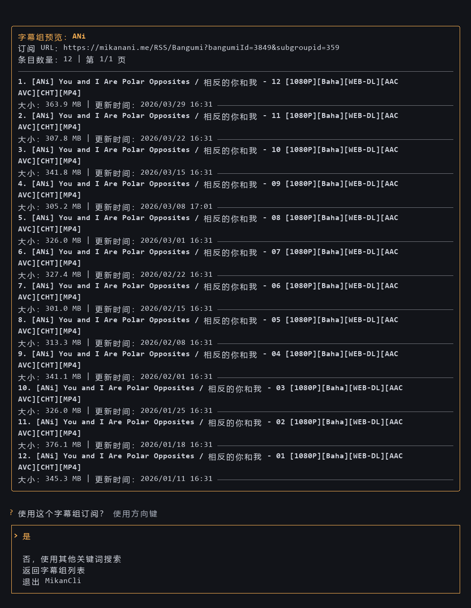

# MikanCli

语言：[简体中文](README.md) | [English](README.en.md)

MikanCli 是一个 Python 命令行工具，用于在 Mikanani.me 搜索动画和字幕组订阅，并生成、提交 qBittorrent RSS 下载规则。

- 搜索动画、选择字幕组 RSS 订阅，并预览发布内容
- 使用包含、排除和最低集数条件过滤发布标题
- 提交 qBittorrent RSS 订阅和下载规则，并验证保存结果
- 通过非交互式 JSON 命令支持 AI Agent 和脚本自动化

## 安装

需要 Python 3.10 或更新版本，推荐使用 `pipx` 安装：

```bash
pipx install mikancli
```

如果尚未安装 `pipx`，请先运行以下命令，重新打开终端后再执行上面的安装命令：

```bash
python -m pip install --user pipx
python -m pipx ensurepath
```

## 使用方法

```bash
mikancli
```

按提示搜索动画、选择字幕组、预览订阅、设置过滤条件和下载位置，然后确认是否提交到 qBittorrent。

也可以在命令中预先指定搜索关键词和过滤条件：

```bash
mikancli "one piece" --include SubsPlease --exclude 720p --min-episode 1126
```

最低集数过滤支持 `One Piece - 1126` 和 `[One Piece][1126]` 等常见标题格式。

## qBittorrent 设置

在 qBittorrent 设置中启用 WebUI（远程控制），然后运行：

```bash
mikancli --setup-qbittorrent
```

默认地址为 `http://localhost:8080`。只有 qBittorrent 已允许本地免认证访问时，用户名和密码才可以留空。

## AI Agent 和脚本

显式命令不会提示交互输入，始终返回 JSON。先查询候选项并选择 ID，再保存、检查和提交规则计划：

```bash
mikancli search "One Piece"
mikancli subgroups --bangumi-id 123
mikancli feed --bangumi-id 123 --subgroup-id 456 --limit 20
mikancli rules plan --bangumi-id 123 --subgroup-id 456 --name "One Piece" --include 1080p > plan.json
mikancli rules apply --file plan.json --if-exists fail
mikancli rules get --name "One Piece"
```

将示例 ID 替换为查询结果中的实际 ID，提交前检查 `plan.json`。在这些命令中，只有 `rules apply` 会写入 qBittorrent，且可能触发 RSS 下载。

重复提交同一计划会返回 `unchanged`；同名规则内容不同时会报冲突，检查现有规则后可显式使用 `--if-exists replace` 替换。

完整的命令参考、JSON 结构、退出码和自动化配置请见 Agent 使用指南：[简体中文](docs/agents.zh-CN.md) | [English](docs/agents.md)。

## 配置与语言

Windows 配置文件位于 `%APPDATA%\MikanCli\config.json`。可通过 `--config PATH` 或 `MIKANCLI_CONFIG` 指定其他配置文件。

qBittorrent 密码会保存在配置文件中，请妥善保护该文件。

引导式流程支持简体中文和英文，可在启动菜单中切换，也可使用 `--language zh-CN`、`--language en` 或环境变量 `MIKANCLI_LANG`；非交互式命令的帮助和错误消息目前使用英文。

查看命令和选项：

```bash
mikancli --help
mikancli search --help
mikancli rules plan --help
```

## 界面预览




## 从源码安装

```bash
git clone https://github.com/JianHua-Deng/MikanCli.git
cd MikanCli
python -m pip install -e .
```
